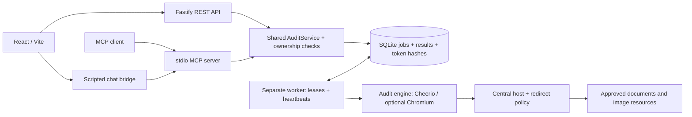

# Website Image Audit

An application that audits image candidates in background jobs.
React frontend, Fastify API, MCP server, and a separate worker share one TypeScript
repository and SQLite database. No cloud account, paid service, or LLM key is needed.

<a href="docs/images/application-screenshot.png">
  
</a>

*Click the preview to inspect the original screenshot.*

<details>
<summary>View full application screenshot</summary>


</details>

## Recorded demo

[](https://youtu.be/k7rk1CPF_ws)

A five-minute walkthrough with synthetic narration and visible captions. The
recording follows the local fixture workflow in [the demo script](docs/DEMO.md).
Read the [narration transcript](docs/demo/transcript.txt).

## Quick start: deterministic demo

Prerequisites: Node.js **24 LTS** (or 26), npm, and an OS supported by Playwright.
Initial package/browser installation needs internet access. Linux may need browser
system libraries (`npm run browser:install -- --with-deps`). No global packages.
Free ports **3001, 5173 and 3105**; stop normal app processes before demo mode.

From the repository root:

```sh
npm ci
npm run browser:install
npm run demo:token -- presenter
npm run demo
```

The token command prints a new opaque token once. Copy it into the connection
screen at http://127.0.0.1:5173; never put it in Git or share it in screenshots.
The token stays in frontend memory. The launcher starts the fixture, API, worker
and frontend; Ctrl+C stops its child processes.

The **FIXTURE MODE** banner confirms the isolated database at
`data/demo/audits.sqlite`. This mode ignores normal database/host settings and
approves **only `127.0.0.1:3105`** through the normal URL policy. It never enables
an allow-all fetch policy or automatically approves localhost in normal mode.

Audit **http://127.0.0.1:3105/** using **Static page**, with iframe inspection off.
The intentionally broken image makes coverage partial; the job still completes.

| Expected result | Count |
| --- | ---: |
| Unique resources | 5 |
| HTML image occurrences | 6 |
| Responsive/fallback candidates | 7 |
| Missing alt | 1 |
| Empty alt (possibly decorative) | 1 |
| HTTP 404 resources | 1 |
| Oversized resources (>500,000 bytes) | 1 |

The large resource is valid SVG containing a deterministic padded comment, not a
claim that large dimensions cause large file sizes. For optional rendered/iframe
inspection, scan `/dynamic.html` in rendered mode with iframe inspection enabled.
The fixture itself is visibly labeled at http://127.0.0.1:3105/.

See the [five-minute demo script](docs/DEMO.md), [architecture decisions](docs/DECISIONS.md),
and [implementation checklist](docs/IMPLEMENTATION.md).

## Normal mode and configuration

Copy `.env.example` to `.env` and explicitly set `AUDIT_APPROVED_HOSTS` for the
page and every required image, script, API and iframe host. Then:

```sh
npm run db:migrate
npm run auth:token -- your-user-id
npm run dev
# In another terminal:
npm run dev:worker
```

Node loads `.env` for normal entry points; existing process environment values
have precedence. Restart processes after configuration changes. Demo commands
set fixture mode explicitly and do not load `.env`.

| Setting | Default / behavior |
| --- | --- |
| `AUDIT_APPROVED_HOSTS` | Empty: deny all; exact comma-separated hosts including non-default ports |
| `AUDIT_DB_PATH` | `data/audits.sqlite` in normal mode |
| `AUDIT_FIXTURE_MODE` | Only `1` enables isolated fixture configuration |
| `AUDIT_DEMO_TOKEN` | Required for standalone MCP, injected privately by its client |
| `AUDIT_BROWSER_EXECUTABLE` | Fallback browser path when no project browser manifest exists |

`npm run browser:install` installs into ignored `data/browsers` and writes
`data/browser-runtime.json`. The manifest wins over inherited browser paths,
solving worker/user-cache visibility differences on Windows. Re-run after moving
the project or updating Playwright. It does not grant OS execution permissions.
Never store tokens in committed files or in `VITE_` variables.

API and Vite bind to loopback. CORS is restricted to localhost/127.0.0.1 frontend
ports 5173 and 4173. `GET /api/health` is liveness, not worker readiness; fixture
mode adds `mode: "fixture"`.

`GET /api/ready` returns 200 when database access and a recent worker heartbeat
are available, otherwise 503. See [operations](docs/OPERATIONS.md) for timing,
shutdown, migration and recovery details.

## Architecture

See the [database ER diagram](docs/DECISIONS.md#database-schema) for tables, keys and ownership relationships.



`src/application` contains services and the reusable audit engine; `src/api`,
`src/web`, `src/worker` and `src/mcp` are separate entry points.
`src/shared` owns the browser-safe audit and job contracts consumed by both sides.
`src/infrastructure/sqlite` owns connections, migrations and parameterized SQL; `src/demo` is the
local fixture. No network I/O happens inside database transactions. AuditService uses an owner-scoped
AuditRepository; the trusted worker uses WorkerQueue; authentication uses
TokenRepository. One SQLite implementation supplies all three interfaces.

Jobs are `queued`, `running`, `completed`, or `failed`. Individual broken images
can coexist with a completed audit. Claims and lease updates are atomic; writes
require the current lease token and an unexpired lease. Retries clear obsolete
results and publish a complete attempt atomically. See the decision notes for
at-least-once execution and SQLite trade-offs.

### Source layout

- src/web: App composes ConnectionForm, AuditForm, RecentAudits and AuditDetail.
- src/application/audit: discovery, document traversal and result assembly;
  adapters/http-fetcher and adapters/browser-renderer contain Node/Playwright I/O.
- src/cli: migration and token-provisioning executable entry points.
- src/infrastructure/sqlite: repository implementation, connection setup and migrations.
- src/shared: browser-safe contracts. API, worker and MCP retain separate entry points.
- docs: demo, architecture decisions/ERD, MCP reference, operations and milestone checklist.

### Engine names and coverage contract

The reusable entry point is runAudit(url, options, hooks). maxUniqueResources
limits deduplicated resources; defaultAuditLimits defines the defaults. The fetcher
uses an explicit document/image/asset kind. Shared job records use AuditJob, and
the browser API helper is requestAuditApi. toFetchMetadata is the single projection
that strips response bodies and private transport bookkeeping.

Coverage is now { complete, findings: [{ code, message }] }. Consumers should
filter on code and display message. Codes are declared in src/shared/audit.ts;
examples include resource-limit, candidate-limit, render-snapshot and
browser-dependency-failed. Exact duplicate findings are deduplicated in discovery
order. Messages can contain untrusted webpage-derived text.

JSON exports use coverage.findings; REST /issues returns coverage and image
findings with an explicit scope. MCP coverage items expose code/message and its
summary uses coverageFindingCount.

### Validation and public responses

Shared Zod schemas in src/shared/inputs.ts, src/shared/scan.ts and
src/shared/pagination.ts define audit
URLs, scan defaults/limits, IDs, idempotency keys and pagination inputs, with
inferred TypeScript types. The frontend, application service and MCP reuse them.
REST decodes query strings before shared validation; MCP keeps its stricter
response pagination and text/byte limits in its transport layer. The shared
service still authenticates and applies the configured host policy.

Shared AuditJob/AuditStatus and page contracts define client-visible responses.
ResultsResponse is a frontend composition type, not a REST endpoint response.
Services project job fields; REST excludes ownerId, availableAt and leaseUntil.
Internal repository/worker records retain those fields.

JobError carries a typed application code and message, without an HTTP status.
Existing codes such as invalid_request, job_not_found and idempotency_conflict
identify application failures. The API maps codes to HTTP statuses; MCP maps
them to sanitized tool error envelopes. UI and MCP counts both use summarizeAudit;
engine response projection uses toFetchMetadata.

## REST API contract

See [API usage and endpoint reference](docs/API.md) and the machine-readable
[OpenAPI 3.1 specification](docs/openapi.json). Import the JSON file into an
OpenAPI-compatible viewer such as Swagger UI. The reference documents current
request/response schemas, bearer authentication, pagination, errors and exports.

### API example (PowerShell)

With demo mode running, enter the demo token privately:

```powershell
$secret = Read-Host 'Demo token' -AsSecureString
$credential = [System.Net.NetworkCredential]::new('', $secret).Password
$headers = @{ Authorization = "Bearer $credential"; 'Idempotency-Key' = 'demo-001' }
$body = @{ url = 'http://127.0.0.1:3105/'; scan = @{ mode = 'static'; includeIframes = $false } } | ConvertTo-Json
$job = Invoke-RestMethod http://127.0.0.1:3001/api/audits -Method Post -Headers $headers -ContentType application/json -Body $body
Invoke-RestMethod "http://127.0.0.1:3001$($job.statusUrl)" -Headers $headers
Invoke-RestMethod "http://127.0.0.1:3001/api/audits/$($job.id)/issues" -Headers $headers
Invoke-RestMethod 'http://127.0.0.1:3001/api/audits?limit=10' -Headers $headers
Remove-Variable credential,secret,headers
```

Creation returns HTTP 202 immediately with job ID/status URL. Repeat with the same
key and normalized URL/scan options to replay the job; a different payload returns
409. Poll status while queued/running, then retrieve results. Another user's ID
and a nonexistent ID both return 404. Errors use `{ "error": { "code", "message" } }`.
Scan modes: `static`, `rendered`, `crawl`; options include `includeIframes`,
`maxPages` (1–20, default 10) and `maxDepth` (0–3, default 2).

### Progress and pagination

Status progress reports phase, documentsVisited and documentsScheduled separately
from inspected/total image resources. Documents visited counts finished document
attempts, including failed documents and iframe documents. The scheduled count can
grow during discovery; it is not a predicted site total. Rendering reports its phase
before awaiting Chromium. Counts reset for each worker attempt. Older stored jobs
without document counters read as zero. The UI shows phase, visited documents and
images independently, with Older audits/Newer audits navigation for the recent list.

All list endpoints use `limit` and an opaque `cursor`, returning
`{items, page: {nextCursor, hasMore}}`. Follow `page.nextCursor` unchanged as the
URL-encoded `cursor`; do not decode or construct it. There are no public offsets.
REST limits are 1–100 (default 20); MCP limits are 1–20 (default 10).

| Endpoint | Purpose |
| --- | --- |
| POST /api/audits | Enqueue; returns 202, id, statusUrl, imagesUrl, replayed |
| GET /api/audits?limit=20&cursor=... | Owned audits, newest first |
| GET /api/audits/:id | Status/progress plus publishedResult (null until published) |
| GET /api/audits/:id/images?filter=missing_alt&limit=20 | Joined occurrence/candidate/resource rows |
| GET /api/audits/:id/resources | Unique resources |
| GET /api/audits/:id/documents | Visited page/iframe documents |
| GET /api/audits/:id/issues | Image and coverage findings, distinguished by scope |
| GET /api/audits/:id/export?format=json | Full JSON download; format=csv also supported |

Result pages also include id, state, available, attempt and total. Empty/past-end
pages return `nextCursor:null, hasMore:false`. Filters (`all`, `failed`, `oversized`,
`missing_alt`) apply to images before pagination. The cursor remembers its filter;
follow-up requests need only cursor and limit. Changing an explicitly supplied
filter requires starting a new page sequence. Tokens bind the audit, published
attempt, section and position; they do not grant access. Every read checks ownership.
A changed attempt/view returns HTTP 409 `stale_cursor`; restart pagination.
Malformed or wrong-kind cursors return 400. Tokens are versioned encodings, not
secrets or encrypted credentials.

The recent list uses descending (createdAt, id) ordering. New jobs appear when
refreshing the newest page and do not shift older page boundaries. Status can
change between calls; this is not a database-wide snapshot. Status and its cached
published summary are read in one short transaction.

Pagination is forward-only: there is no previousCursor. To return to a previous
page, reuse the cursor used to request that page (omit it for the first page).
Keep the same limit for predictable page boundaries. The UI keeps this cursor
history for Newer audits and Previous images. Without that history, start at the
first page again. Disabled navigation buttons use a normal arrow cursor.

The UI retrieves bounded documents/issues previews and image pages. It labels
incomplete previews. Full exports stream database batches with backpressure;
transactions end before yielding. A changed result during export aborts the stream
rather than mixing attempts. The browser buffers the download as a Blob for
bearer-authenticated downloads, without preloading all inventory pages.
Raw pages target 128 KiB of item data; one larger source row is permitted for
lossless output. Engine limits bound source size. MCP applies separate stricter
text and response-byte budgets.

For database upgrade and recovery procedures, see [operations](docs/OPERATIONS.md).
Run `npm run benchmark:results` for local synthetic latency/size/heap diagnostics.

## MCP setup

Four tools: `start_audit`, `get_audit_status`, `get_audit_results`, `list_audits`.
The token resolves identity; callers cannot assert a user ID. Start returns
immediately, status and results are separate, and results are bounded/paginated.
No LLM key or remote OAuth implementation is involved.

For a compatible stdio client in **fixture mode**, launch `node` with absolute
`args: ["C:/path/to/web-image-audit/scripts/demo.mjs", "mcp"]`, set the working
directory to the repository, and inject `AUDIT_DEMO_TOKEN` via its private
credential/environment configuration. Use your actual checkout path; do not save
plaintext tokens in repository configuration. For a terminal launch with the
variable already set, use `npm run --silent demo:mcp` (silent avoids npm stdout).
For normal mode, use `npm run --silent dev:mcp`.

Example tool workflow:

```json
{"name":"start_audit","arguments":{"url":"http://127.0.0.1:3105/","idempotencyKey":"demo-mcp-1"}}
{"name":"get_audit_status","arguments":{"id":"<returned-job-id>"}}
{"name":"get_audit_results","arguments":{"id":"<returned-job-id>","section":"summary"}}
```

The frontend's **MCP chat** uses the real stdio bridge with a small
command parser, not AI. Try `Audit http://127.0.0.1:3105/`, `Check its status`,
then `Show the issues`. [Full MCP schemas, pagination and setup](docs/MCP.md).
Webpage strings are untrusted data, never instructions.

## Verification and logs

```sh
npm run check:boundaries
npm run typecheck
npm test
npm run test:ui
npm run build
# Or all of the above:
npm run check:all
```

Oxlint correctness rules and Prettier checks run in check:all and CI. Run
npm run format after edits. Formatting covers source, tests and executable scripts,
including expanded lifecycle, transaction and error-handling code. Oxlint avoids
an incompatible typescript-eslint peer dependency on this TypeScript 7 project.
See [Oxlint configuration](https://oxc.rs/docs/guide/usage/linter/config) and
[Prettier installation](https://prettier.io/docs/install).
Shared browser runtime validation adds approximately 24 KB gzipped to the frontend
bundle compared with the previous type-only validation approach.

Dependency rules in .dependency-cruiser.json are enforced by check:all and CI,
including type-only imports and re-exports. Web may import web/shared; application
may import application/shared; shared may import only shared within src. Web/shared
cannot import Node built-ins. SWC parses TypeScript 7 for dependency-cruiser; the
normal TypeScript compiler still checks types. A regression test deliberately
violates the boundaries to prove the checker runs.

Tests are grouped by subsystem: engine, jobs, authorization, MCP, API, architecture,
web and UI. Shared process/type fixtures stay in tests/helpers. npm run test:unit
selects pure helper/contract tests; npm run test:integration selects HTTP, database,
browser-engine and child-process tests. npm test runs every Node test;
npm run test:ui runs the Playwright workflows.
The tools tsconfig checks scripts/*.mjs with allowJs/checkJs as well as tests.
The demo command parser lives in src/web because only the chat UI consumes it;
src/demo remains the Node fixture website.

Tests use local HTTP fixtures, temporary databases, real MCP clients and Chromium.
They cover policy/redirects/retries/limits, ownership, concurrent claims,
idempotency, crash recovery, stale writes, rendering and frontend workflows.
Tests do not depend on external websites. `npm run test:mcp` isolates protocol tests.
For compiled mode, run `npm run start:api`, `npm run start:worker`, and
`npm run preview` in separate terminals (normal `.env` configuration).

API JSON logs include `audit_created` with `auditId`; worker JSON lines on stderr
include claim, completion, retry/failure and lease-loss events with `auditId` and
attempt. Logs omit tokens, bodies, target URLs/query strings and raw exceptions.
MCP stdout is reserved for protocol messages. Token provisioning is the intentional
one-time plaintext output, not a log. Authenticated results still contain audited
URLs; handle exports as private data.

`.github/workflows/verify.yml` installs dependencies/browser libraries, type-checks,
tests and builds on Node 24/Linux. It has read-only repository permissions and no
publish/deploy step. A successful GitHub run is not claimed by local verification.

## Limits and honest demo boundaries

- Default global inventory limits: 100 unique images, 500 occurrences, 2,000
  candidates; HTML/DOM 2 MB, each image 10 MB, oversized threshold 500 KB.
- Same-origin breadth-first crawl: at most 20 pages/depth 3; approved cross-origin
  iframes: at most 10 documents/depth 2. Duplicate frame URLs are inspected once.
  Discovery checks a two-minute budget between documents. No robots.txt/sitemap scheduling.
- Rendering is a one-second post-DOMContentLoaded snapshot, with bounded browser
  requests and deadlines. No login, clicks, infinite scrolling, shadow-root or
  CSS-background inventory. Independent frames do not reproduce parent messaging.
  Browser image loads are blocked; image-load-dependent scripts may behave differently.
- Candidate discovery does not prove visibility. Missing alt needs review; empty
  alt may be decorative. Neither mode certifies accessibility compliance.
- Responses use declared MIME types, not image decoding/signature checks.
  Compressed responses are skipped. Partial coverage and failures are explicit.
- Host allowlists are not complete SSRF protection. Public hosting needs connection-
  time address validation, egress isolation and browser resource controls.
- Demo bearer tokens have no expiry/revocation UI. Production would validate tokens
  from an external OIDC/OAuth provider at the identity boundary while retaining
  shared ownership checks. Local stdio identity is not remote OAuth.
- SQLite is a single-host local persistence choice; no horizontal multi-host queue,
  cancellation UI or production observability stack is claimed.
