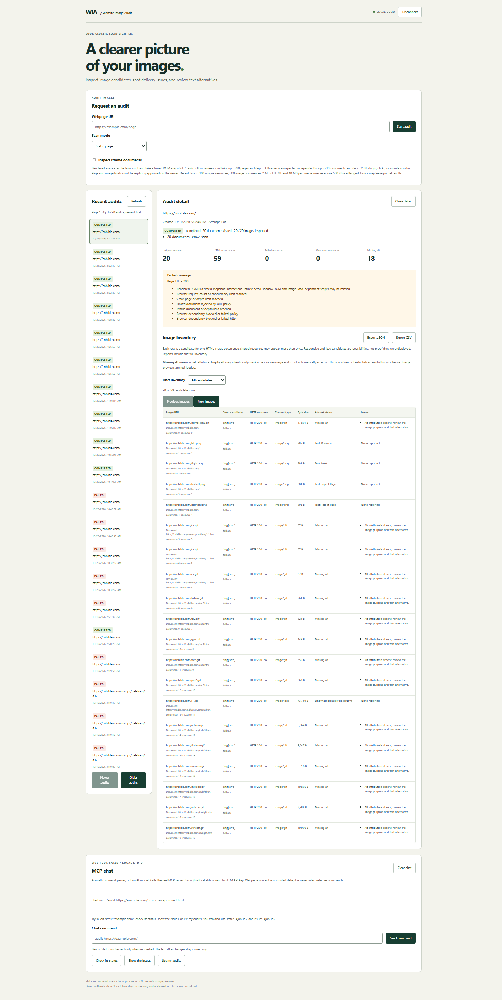
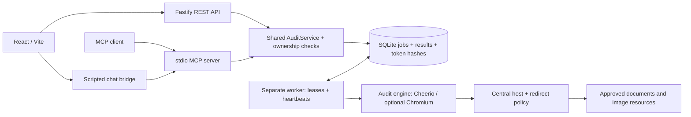

# Website Image Audit

**Find broken images, oversized files, and missing alternative text before you publish a webpage.**

Submit a URL, let the background scan finish, then filter and export findings.
Use it before launch or after content changes to identify image URLs to repair,
files to optimize, and alt attributes to review.

**Current focus:** broken image requests, file-size checks, and missing versus
empty alt. Empty alt may be intentional for decorative images.

**Roadmap:** I plan to add checks incrementally, working toward more comprehensive,
near-complete inspection within a clearly defined scope. That is a direction,
not a current capability or a promise to detect every issue. The app does not
repair images, measure page speed, or certify accessibility.

Runs locally through a web UI or MCP tools, without a cloud account or LLM key.

<a href="docs/images/application-screenshot.png">
  
</a>

*Click the preview to inspect the original screenshot.*

<details>
<summary>View full application screenshot</summary>


</details>

## Recorded demo

[](https://youtu.be/c02-FO0BsCw)

A 6-minute walkthrough with synthetic narration and visible captions, using the
local fixture. The [revised five-minute demo script](docs/DEMO.md) starts with the
problems the app helps you find; it has not yet been recorded.

## Quick start: deterministic demo

Prerequisites: Node.js **24 LTS** (or 26), npm, and an OS supported by Playwright.
Initial package/browser installation needs internet access. Linux may need browser
system libraries (`npm run browser:install -- --with-deps`). No global packages.
Free ports **3001, 5173 and 3105**; stop normal app processes before demo mode.

From the repository root:

```sh
npm ci
npm run browser:install
npm run demo
```

Open http://127.0.0.1:5173. Fixture mode signs in automatically as the shared
`fixture-demo` identity; no token entry is needed. A real bearer token stays in
browser memory, and ownership checks still apply. Disconnect clears it; reload
signs in again. Normal mode still requires a provisioned token.
The launcher starts the fixture, API, worker and frontend; Ctrl+C stops its children.

The **FIXTURE MODE** banner confirms the isolated database at
`data/demo/audits.sqlite`. This mode ignores normal database/host settings and
approves **only `127.0.0.1:3105`** through the normal URL policy. It never enables
an allow-all fetch policy or automatically approves localhost in normal mode.

Audit **http://127.0.0.1:3105/** using **Static page**, with iframe inspection off.
The intentionally broken image makes coverage partial; the job still completes.

| Expected result | Count |
| --- | ---: |
| Unique resources | 5 |
| HTML image occurrences | 6 |
| Responsive/fallback candidates | 7 |
| Missing alt | 1 |
| Empty alt (possibly decorative) | 1 |
| HTTP 404 resources | 1 |
| Oversized resources (>500,000 bytes) | 1 |

The fixture uses local landscape illustrations in padded cards, with captions
explaining each case. Responsive images switch between sunset and daylight views.

The large resource is valid SVG containing a deterministic padded comment, not a
claim that large dimensions cause large file sizes. For optional rendered/iframe
inspection, scan `/dynamic.html` in rendered mode with iframe inspection enabled.
The fixture itself is visibly labeled at http://127.0.0.1:3105/.

See the [five-minute demo script](docs/DEMO.md), [architecture decisions](docs/DECISIONS.md),
and [implementation checklist](docs/IMPLEMENTATION.md).

## Normal mode and configuration

Copy `.env.example` to `.env` and explicitly set `AUDIT_APPROVED_HOSTS` for the
page and every required image, script, API and iframe host. Then:

```sh
npm run db:migrate
npm run auth:token -- your-user-id
npm run dev
# In another terminal:
npm run dev:worker
```

Node loads `.env` for normal entry points; existing process environment values
have precedence. Restart processes after configuration changes. Demo commands
set fixture mode explicitly and do not load `.env`.

| Setting | Default / behavior |
| --- | --- |
| `AUDIT_APPROVED_HOSTS` | Empty: deny all; exact comma-separated hosts including non-default ports |
| `AUDIT_DB_PATH` | `data/audits.sqlite` in normal mode |
| `AUDIT_FIXTURE_MODE` | Only `1` enables isolated fixture configuration |
| `AUDIT_DEMO_TOKEN` | Required for standalone MCP, injected privately by its client |
| `AUDIT_BROWSER_EXECUTABLE` | Fallback browser path when no project browser manifest exists |

`npm run browser:install` installs into ignored `data/browsers` and writes
`data/browser-runtime.json`. The manifest wins over inherited browser paths,
solving worker/user-cache visibility differences on Windows. Re-run after moving
the project or updating Playwright. It does not grant OS execution permissions.
Never store tokens in committed files or in `VITE_` variables.

API and Vite bind to loopback. CORS is restricted to localhost/127.0.0.1 frontend
ports 5173 and 4173. `GET /api/health` is liveness, not worker readiness; fixture
mode adds `mode: "fixture"`.

`GET /api/ready` returns 200 when database access and a recent worker heartbeat
are available, otherwise 503. See [operations](docs/OPERATIONS.md) for timing,
shutdown, migration and recovery details.

## Architecture

React/Vite, Fastify, a separate worker, and a stdio MCP server share TypeScript
application services and SQLite. Ownership checks apply to REST and MCP; worker
leases prevent stale attempts from publishing results.



## Verification

```sh
npm run check:all
```

Runs lint, formatting, dependency boundaries, tests, strict type checks, build,
and browser UI tests. Tests use local fixtures and temporary databases.

## Limits

- Static parsing, optional JavaScript snapshots, bounded same-origin crawling,
  and opt-in iframe inspection; no login, clicks, or infinite scrolling.
- Default limits: 100 unique resources, 500 occurrences, 2 MB HTML/DOM, 10 MB per
  image; files above 500 KB are flagged. Partial coverage is reported.
- Responsive candidates are possibilities, not proof of visibility. No automatic
  remote image previews; content types are checked without decoding image pixels.
- Explicit host approval is required, but an allowlist is not complete SSRF
  protection. Authentication and SQLite deployment are for a local demo.

## Reference

| Document | Contents |
| --- | --- |
| [Demo script](docs/DEMO.md) | Short walkthrough to review before recording |
| [API reference](docs/API.md) / [OpenAPI](docs/openapi.json) | Current endpoints, schemas, pagination, exports, and examples |
| [MCP setup](docs/MCP.md) | Client configuration and tool workflow |
| [Operations](docs/OPERATIONS.md) | Database, migrations, readiness, logs, and recovery |
| [Architecture decisions](docs/DECISIONS.md) | Trade-offs and database ER diagram |
| [Implementation checklist](docs/IMPLEMENTATION.md) | Milestone status |
