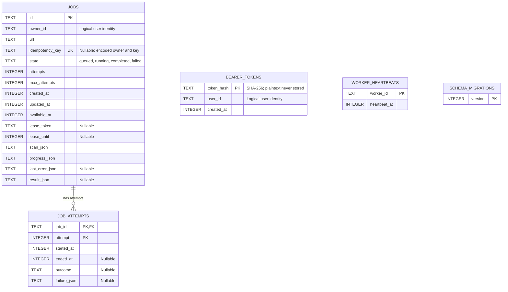

# Architecture decision notes

## SQLite instead of a hosted database

Decision: one SQLite file with migrations, parameterized queries and WAL. It makes
installation, local ownership and transactional queue/result changes inspectable.
Trade-off: one writer at a time, a local file and bounded busy waits. This is not a
multi-host deployment. A hosted relational database fits concurrent servers,
managed backups and availability, but adds credentials, service cost and operations.

## Database schema

The schema after migration 4 contains four application tables and one migration
tracking table. Source: [migrations.ts](../src/infrastructure/migrations.ts).

- Jobs to attempts is the only foreign-key relationship. An attempt is identified
  by the composite primary key (job_id, attempt).
- jobs.owner_id and bearer_tokens.user_id identify the same logical user through
  application ownership checks. There is no users or tenants table and no foreign
  key between tokens and jobs. Multiple tokens can belong to one user.
- Image resources, occurrences, documents and findings are nested in result_json,
  rather than separate relational tables. scan_json stores the requested scan options.
- Worker heartbeats report process readiness independently of per-job lease tokens.
- schema_migrations records applied versions. Timestamps are Unix milliseconds.
- Token records currently have no expiry or revocation fields.

## Database queue instead of SQS

Decision: reuse SQLite for durable queued/running/completed/failed state and
atomic idempotency checks. No network transaction is held during auditing.
Trade-off: worker polling, lease recovery and attempt history are our responsibility.
SQS supplies managed delivery/visibility but requires cloud infrastructure and still
needs idempotent consumers, ownership, durable results and stale-write protection.

## Leases and stale-worker fencing

Claims run in short immediate transactions. A random lease token and expiration
identify the current worker; heartbeats renew the lease. Every progress/final write
checks both token and expiration. Recovery requeues expired jobs up to the attempt
limit. Result writes replace the attempt snapshot atomically and retries clear old
results. This gives at-least-once execution, not exactly-once network activity.
Clock and process pauses can cause duplicate inspection; stale workers cannot publish.
Graceful shutdown stops claiming and drains the current bounded audit.

## Shared REST and MCP services

Decision: both transports call AuditService for identity/ownership and idempotency.
Routes and MCP schemas validate transport shapes; neither accepts a caller user ID
as proof of identity. The worker queue is a trusted internal boundary.
Trade-off: transports still have separate DTOs; MCP deliberately truncates/paginates
large results. The UI's scripted bridge launches short-lived stdio processes for
clarity, accepting startup overhead. It is not a remote MCP/OAuth transport.

### Persistence interfaces

Persistence uses three narrow interfaces over one SqliteJobStore implementation:

- AuditRepository: creation and reads require an explicit owner ID. AuditService
  obtains that ID from authentication; callers cannot supply it as proof of identity.
  Missing/blank ownership is rejected at runtime and SQL always filters owner_id.
- WorkerQueue: privileged cross-owner claims and lease-fenced heartbeat, progress,
  completion and failure operations. Only the trusted worker receives this interface;
  it has no arbitrary audit reads or token methods.
- TokenRepository: hash storage and token-to-user lookup for authentication and
  local provisioning, with no audit or queue operations.

These are TypeScript capability boundaries, not a sandbox for malicious in-process
code. API and MCP continue to authenticate through AuditService. The SQLite class
implements all three so connection handling and transactions remain centralized.

## Static parsing and optional browser rendering

Decision: static Cheerio discovery remains the default. Optional Chromium snapshots
and bounded crawls/iframe inspection cover some JavaScript-created content.
All external fetches retain exact-host approval and redirect/byte/deadline controls.
Trade-off: rendering adds browser installation, execution risk and more dependencies;
timed snapshots and isolated frames are not faithful full interactive sessions.
The project-local browser manifest makes the runtime visible to the same worker
that consumes jobs. Browser downloads and runtime manifests are not repository data.
Neither discovery strategy establishes visibility or accessibility compliance.
