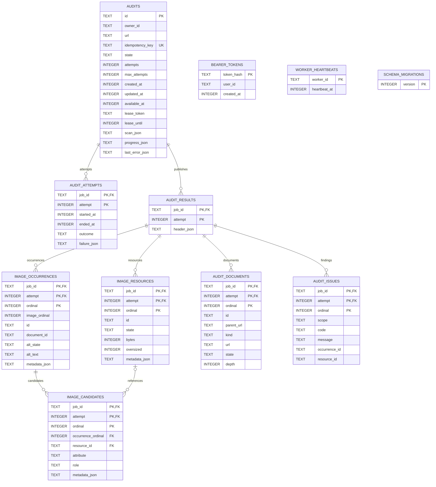
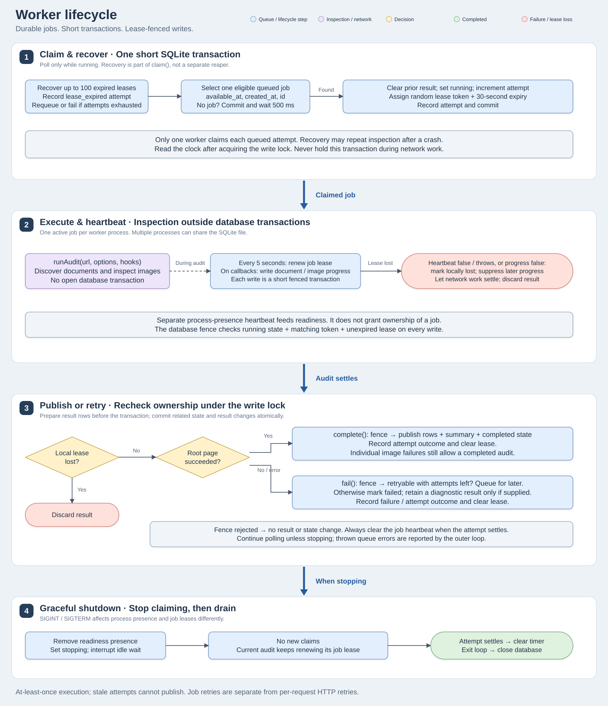
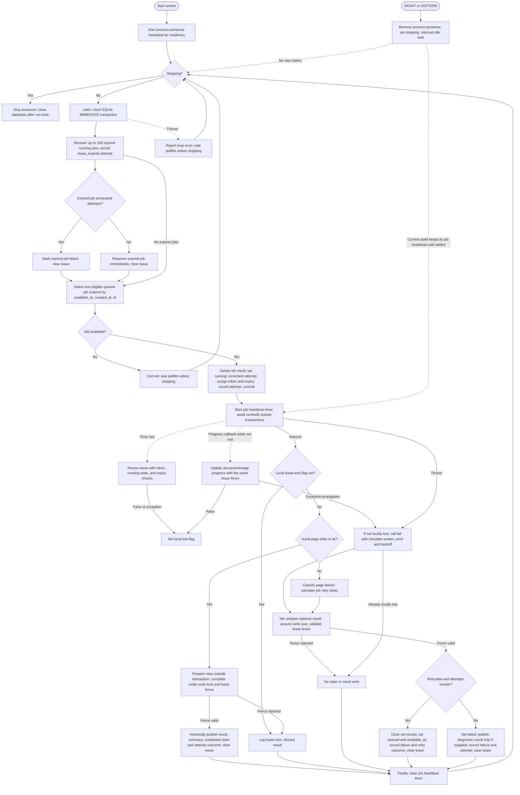
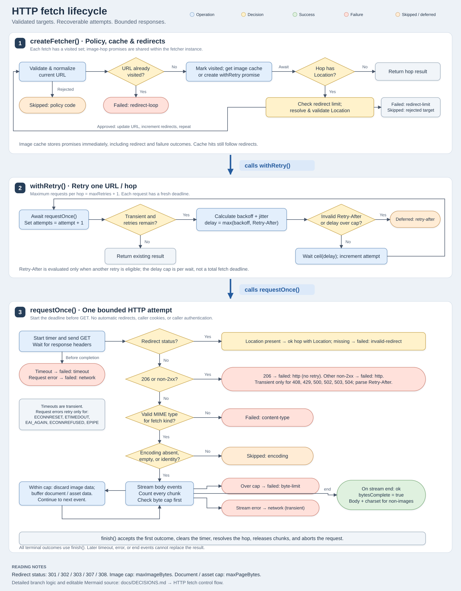
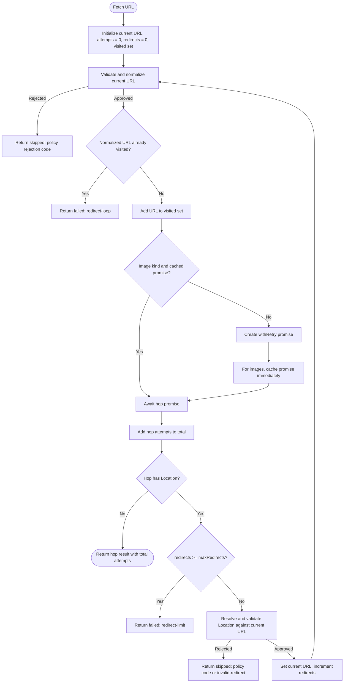
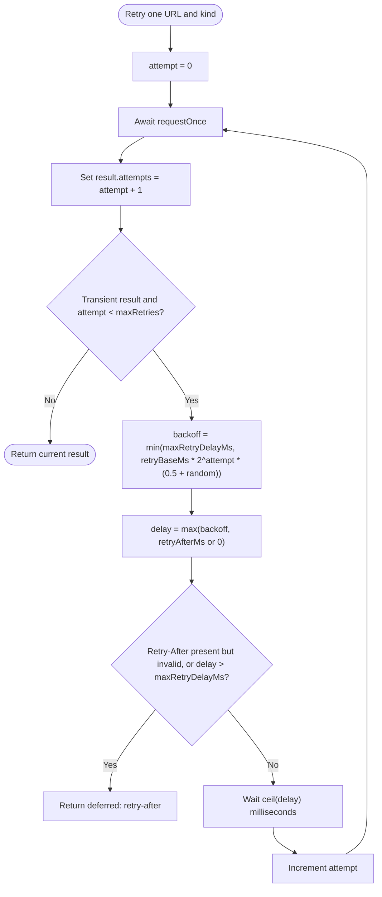
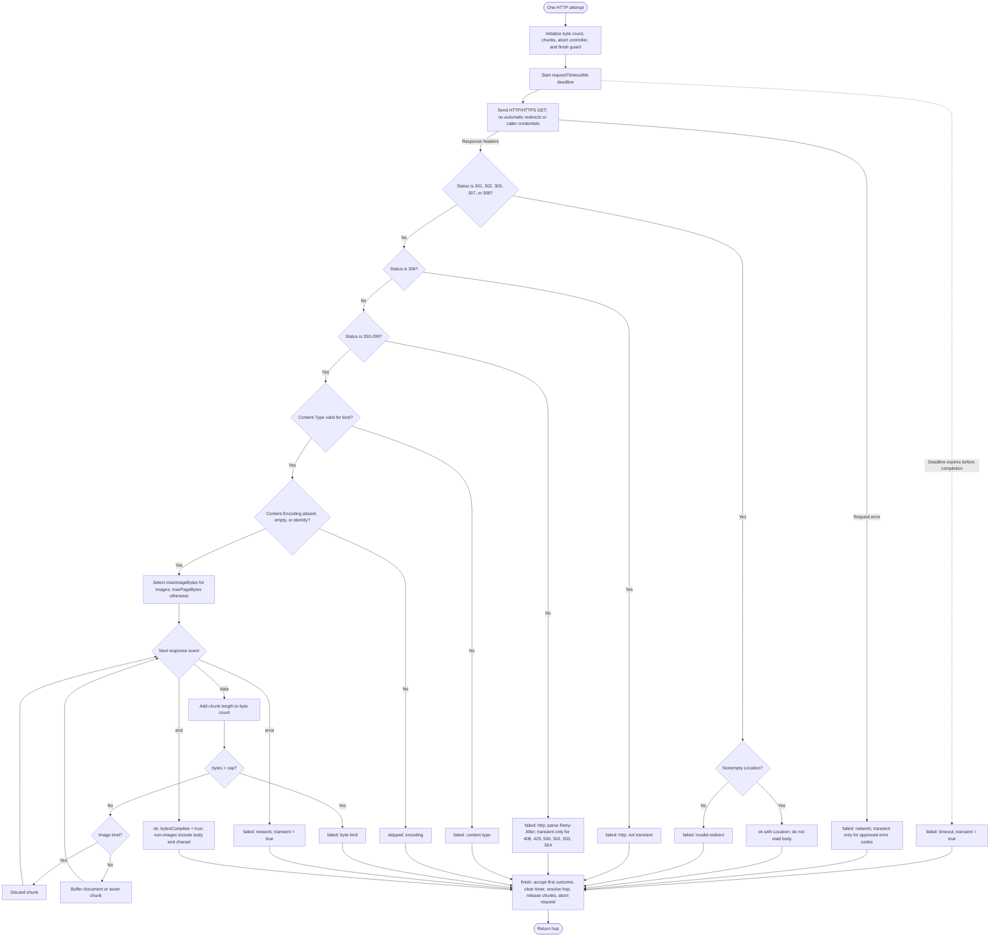

# Architecture decision notes

## SQLite instead of a hosted database

Decision: one SQLite file with migrations, parameterized queries and WAL. It makes
installation, local ownership and transactional queue/result changes inspectable.
Trade-off: one writer at a time, a local file and bounded busy waits. This is not a
multi-host deployment. A hosted relational database fits concurrent servers,
managed backups and availability, but adds credentials, service cost and operations.

## Database schema

Normalized result storage separates files from their HTML uses. Sources:
[migrations.ts](../src/infrastructure/sqlite/migrations.ts) and
[results.ts](../src/infrastructure/sqlite/results.ts).

- The ERD shows database cardinality: (job_id, attempt) permits multiple result
  headers per audit. Application publication keeps at most one by deleting the
  previous header in the same transaction; job_id alone is not UNIQUE.
- Children are scoped by (job_id, attempt), with cascading deletion from the
  published result. Candidate resource and occurrence references use composite
  foreign keys so references cannot cross audits/attempts. Resource and occurrence
  IDs are unique within an attempt. Document IDs and issue references retain
  diagnostic provenance; they are not all foreign-key constrained.
- Each candidate stores only its own metadata, not a resource/occurrence snapshot.
  Inventory is joined at read time. Occurrence alt state remains independent of
  shared resource outcomes. Occurrences without candidates still get an image row.
- Filter columns (resource state/oversized and occurrence alt_state) are explicit
  and indexed. Optional fetch/browser metadata stays JSON; it is not duplicated
  in candidate or inventory snapshots. Cached summary/counts are deliberate
  derived data published in the same transaction as rows.
- audits.owner_id and bearer_tokens.user_id identify the same logical user through
  service checks. There is no users/tenants table or token-to-audit foreign key.
  Multiple tokens may belong to a user; token expiry/revocation is not implemented.
- Worker readiness heartbeats are independent of job leases. Timestamps are Unix
  milliseconds; schema_migrations records applied versions.

## Database queue instead of SQS

Decision: reuse SQLite for durable queued/running/completed/failed state and
atomic idempotency checks. No network transaction is held during auditing.
Trade-off: worker polling, lease recovery and attempt history are our responsibility.
SQS supplies managed delivery/visibility but requires cloud infrastructure and still
needs idempotent consumers, ownership, durable results and stale-write protection.

## Leases and stale-worker fencing

Claims run in short immediate transactions. A random lease token and expiration
identify the current worker; heartbeats renew the lease. Every progress/final write
checks both token and expiration. Recovery requeues expired jobs up to the attempt
limit. Result writes replace the attempt snapshot atomically and retries clear old
results. This gives at-least-once execution, not exactly-once network activity.
Clock and process pauses can cause duplicate inspection; stale workers cannot publish.
Graceful shutdown stops claiming and drains the current bounded audit.

### Worker lifecycle

Sources: [runner](../src/worker/runner.ts), [process lifecycle](../src/worker/main.ts),
and [SQLite queue](../src/infrastructure/sqlite/job-store.ts).

Claim and publication use short database transactions; inspection runs outside them.
The SVG is a compact overview; the Mermaid below retains the detailed branches.

Worker lifecycle — editable Mermaid source

- Defaults: one job per process, 30-second lease, five-second job heartbeat, and
  500 ms idle polling. Other processes may claim different jobs concurrently.
- Readiness presence is separate from the job lease. A false/throwing lease
  heartbeat marks the attempt locally lost. Network work is not cancelled;
  subsequent progress is suppressed and returned results are discarded.
- The database independently checks running state, token, and unexpired lease
  under the write lock. A heartbeat is not permission to publish later.
- Root-page success permits completion despite individual image failures.
  Retryable page failures honor Retry-After up to one day and exponential job
  backoff; longer Retry-After values are non-retryable. Unexpected worker errors
  request a bounded retry. A terminal failure may retain a supplied diagnostic result.
- Recovery happens during claim polling, not in a separate reaper. A crashed
  worker's lease must expire before recovery; duplicate inspection remains possible.
- Graceful shutdown stops new claims and drains work with job heartbeats. If a
  queue write throws, the outer loop reports it; any remaining lease can expire
  and be recovered. No exactly-once execution or forced-cancellation guarantee.

## Shared REST and MCP services

AuditService centralizes ownership and idempotency; shared schemas validate inputs
and public DTOs exclude lease/owner internals. Transport adapters map application
errors and apply their own response bounds. Dependency rules enforce layer imports.

### Persistence interfaces

One SQLite implementation supplies three narrow capabilities:

- **AuditRepository:** owner-required creation/reads; identity comes from authentication.
- **WorkerQueue:** trusted cross-owner claims and lease-fenced writes, without token methods.
- **TokenRepository:** token hashes and user lookup, without audit/queue operations.

This reduces accidental privilege use; TypeScript interfaces are not an in-process
security sandbox. The scripted MCP bridge trades process-startup overhead for
short-lived sessions. Remote OAuth is outside this local demonstration.

## Static parsing and optional browser rendering

Decision: static Cheerio discovery remains the default. Optional Chromium snapshots
and bounded crawls/iframe inspection cover some JavaScript-created content.
All external fetches retain exact-host approval and redirect/byte/deadline controls.
Trade-off: rendering adds browser installation, execution risk and more dependencies;
timed snapshots and isolated frames are not faithful full interactive sessions.
Neither discovery strategy establishes visibility or accessibility compliance.

## HTTP fetch control flow

The [HTTP adapter](../src/application/audit/adapters/http-fetcher.ts) separates
redirect traversal, per-hop retries, and a single request. Expand each diagram
for its control flow. These diagrams describe Node HTTP fetching, not Chromium's
entire request lifecycle.

The SVG summarizes the three layers in compact, color-coded panels. The Mermaid
source below retains the detailed branches; keep the SVG aligned when these flows change.

1. createFetcher(): policy, image-hop cache, and redirects

The cache belongs to one fetcher instance and stores image-hop promises, including
redirects and failures. Cache hits still undergo redirect handling. Attempt totals
include cached hop metadata; they are not counts of newly issued network requests.

2. withRetry(): retry eligibility and Retry-After

At most `maxRetries + 1` requests run per hop. Retry-After is inspected only when
another retry is eligible; an exhausted retry loop returns the existing failure.
The delay limit is per wait, not a total fetch deadline. Each request gets a fresh
deadline, and each redirect hop gets its own retry budget.

3. requestOnce(): deadline, response validation, and streaming

Documents accept HTML/XHTML, images require an image MIME type, and assets require
a nonempty content type. Request-error retry codes are `ECONNRESET`, `ETIMEDOUT`,
`EAI_AGAIN`, `ECONNREFUSED`, and `EPIPE`; response-stream errors are always marked
transient. Only a completed body sets `bytesComplete = true`. The first completion
wins; later timeout/error/end events cannot replace its result.

## Database-backed pagination

Public REST/MCP pages use versioned opaque cursors and the same page envelope.
Positions are validated and ownership is checked on every read. Recent audits use
an indexed (owner, created_at, id) keyset. Result cursors bind a published attempt,
section and filter so retry publication cannot silently mix pages.

Result rows use composite ordinal keys. Image pages join normalized occurrences,
candidates and resources, with indexed issue lookups in the same statement; there
are no application-level per-candidate queries. The joined display ordering can
require a temporary sort over the engine-bounded candidate set. Filtered totals
also require counting matches; we do not claim constant-time arbitrary site-scale
queries. Separate resource/filter indexes support outcome queries. Raise engine
limits only after profiling these joins/counts.

The engine still assembles one bounded result in memory before publication. SQL
rows/metadata are prepared outside the write transaction, then atomically published
with the summary and terminal state under the lease fence. Exports honor
backpressure and yield between batches without holding transactions.
[Upgrade procedures](OPERATIONS.md#database-and-upgrades) cover migration risks.

Use `npm run benchmark:results` for repeatable local diagnostics. Timing and sampled
heap allocation are not production SLOs or peak-memory guarantees. Tests assert
ownership, cursor stability, publication rollback, migration fidelity, and indexed
keyset/resource lookups rather than machine-dependent timing thresholds.
